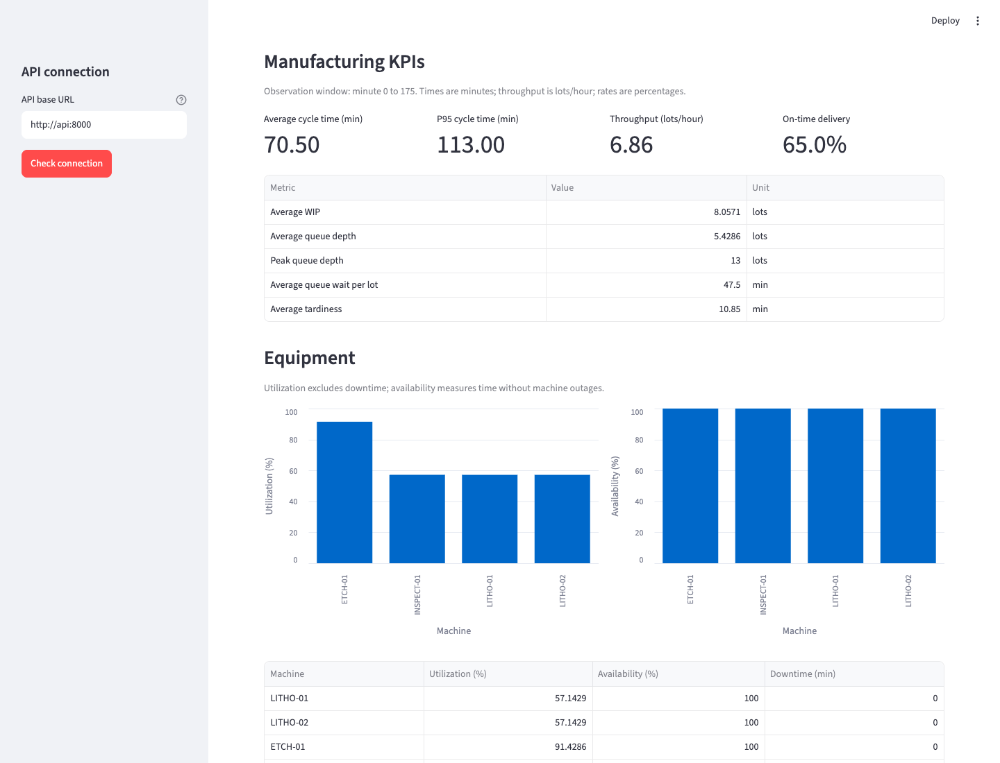
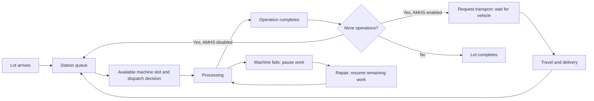

# FabFlow

FabFlow is a Python discrete-event simulator for studying dispatching decisions
in a simplified semiconductor fab. Synthetic wafer lots compete for machine
capacity across Lithography, Etching, and Inspection. Reproducible experiments
compare cycle time, throughput, on-time delivery, and equipment utilization.

**Day 1–5 are implemented and locally validated:** domain models, multi-stage
simulation, FIFO/SPT/Critical Ratio dispatching, Hot lot insertion with Normal
lot aging protection, machine failure/repair, finite AMHS vehicles, and KPI comparison reports.
The FastAPI service supports synchronous run creation, result queries, input
validation, error handling, and health checks, with full API workflow acceptance.
Day 6 is complete locally: Streamlit supports connection checks, preset simulation
submission, completion summaries, and KPI charts. Docker Compose integration is
validated locally, including real desktop Chrome acceptance for both scenarios
and all three policies. Day 7 verification, handoff documents, and portfolio are
prepared; final GitHub delivery is pending.

> This project uses synthetic data and a simplified semiconductor manufacturing
> model. It does not contain proprietary TSMC manufacturing data.

## Dashboard Preview



Real browser capture using synthetic data, FIFO, seed 42, and a 30-minute aging
threshold. See the [portfolio summary and AMHS screenshots](docs/portfolio.md)
for experiment findings, engineering decisions, verification evidence, and limits.

## Quick Start

Requires Python 3.12+ and Git. CI is configured for Python 3.12. Day 6 unit and
integration checks ran on Python 3.14.6; container acceptance used Python 3.12.15.
Day 7 repeated the full suite and coverage on Python 3.12.14.
Run these commands from the repository root:

```bash
python3 -m venv .venv
source .venv/bin/activate
python -m pip install -e ".[dev]"
python -m app.simulation.demo
```

The default 20-lot, three-stage demo produces:

```text
Completed lots: 20
Average cycle time: 70.5 minutes
Throughput: 6.86 lots/hour
```

This baseline has fixed processing times and no failures. Its last lot finishes
at minute 175. To preview the five-lot scenario and its four machines:

```bash
python -m simulator.scenarios.baseline
```

The installed `fabflow` command only prints project information. Use the module
commands above to execute simulations.

## Run the HTTP API (Day 5)

After installing the project, start the service from the repository root:

```bash
python -m uvicorn app.main:app --host 127.0.0.1 --port 8000
```

Open [Swagger UI](http://localhost:8000/docs), select `POST /api/v1/runs`, click
**Try it out**, and paste [the baseline request](docs/examples/baseline.json).
Click **Execute** and copy the returned `run_id` into the query endpoints.
The [complete walkthrough](docs/day5-api.md) also includes an AMHS example.

| Method | Endpoint | Result |
| --- | --- | --- |
| POST | `/api/v1/runs` | Execute a simulation; return 201 with a completed run summary |
| GET | `/api/v1/runs/{run_id}` | Run summary and execution settings |
| GET | `/api/v1/runs/{run_id}/metrics` | Manufacturing, equipment, and transport KPIs |
| GET | `/api/v1/runs/{run_id}/events` | Complete event list in simulation order |
| GET | `/health/live` | Process liveness |
| GET | `/health/ready` | Application readiness; 503 when unavailable |

From another terminal, submit the same request:

```bash
curl --fail-with-body -i http://127.0.0.1:8000/api/v1/runs \
  -H 'Content-Type: application/json' \
  --data-binary @docs/examples/baseline.json
# Replace RUN_ID with the run_id returned by POST.
curl --fail-with-body http://127.0.0.1:8000/api/v1/runs/RUN_ID/metrics
```

The request contains a scenario, `policy` (`FIFO`, `SPT`, or `CR`), and
`normal_wait_threshold` (default 60 minutes). Lot routes reference process step
IDs. Optional machine reliability and AMHS settings use the same engine rules
as Python simulations. Each POST creates a fresh engine and a unique run ID;
it returns only after all lots finish. The `Location` header identifies the run.

Invalid inputs return 422 with field locations and reasons; unknown run IDs
return 404. Unexpected server failures return a generic 500 JSON response and
are logged on the server. Failed runs do not publish partial results.

Results live in application memory with no automatic expiry. Use one worker:
processes do not share results, and restarting or reloading clears them. This
MVP uses synchronous execution without a database or background job queue.

## Day 6 Progress: Dashboard and Docker Compose

All five Day 6 steps are complete and locally validated:

| Step | Deliverable | Status |
| --- | --- | --- |
| 1 | Streamlit entry point, configurable API address, readiness checks | Complete |
| 2 | Baseline/AMHS presets, FIFO/SPT/CR, aging threshold, run creation and summary | Complete |
| 3 | Manufacturing KPIs, equipment charts, AMHS charts, saved results and refresh | Complete |
| 4 | Python 3.12 containers, single-worker API, Compose networking and health checks | Complete |
| 5 | Real Chrome acceptance for both scenarios and all three dispatch policies | Complete |

Browser acceptance also covers KPI refresh, API-address isolation, and recovery
after invalid input. It found and fixed the KPI button label update after the
first successful load. Screenshots and traces are generated locally under
`artifacts/browser/` and uploaded by the CI workflow. Both `quality` and
`containers` passed for commit `2d83879`, including Chromium browser acceptance:
[verified CI run](https://github.com/j22868706/sideproject_fabflow/actions/runs/39043904601).
Day 7 verification and handoff materials are prepared; final GitHub delivery is pending.

For handoff, use the [operation runbook](docs/runbook.md) and
[reproducible demo walkthrough](docs/demo-walkthrough.md), including expected
results, exports, troubleshooting, and shutdown.

### Run with Docker Compose

With Docker running, start both services from the repository root:

```bash
docker compose up --build --wait --wait-timeout 120
```

Open the dashboard at http://localhost:8501 and Swagger at http://localhost:8000/docs.
The dashboard connects to `http://api:8000` inside the Compose network. Select
**Check connection**, run a preset simulation, then select **Load KPIs**.

Run container HTTP acceptance and stop the stack:

```bash
docker compose exec -T dashboard python - < scripts/smoke_containers.py
docker compose down
```

API results are held in memory and lost when the API restarts. See the
[container setup and validation record](docs/day6-dashboard.md#step-4-docker-compose-integration-implemented-and-validated-locally).

### Run the Dashboard Locally

Install the optional dashboard dependencies, then start the API and dashboard
in separate terminals:

```bash
python -m pip install -e ".[dev,dashboard]"
python -m uvicorn app.main:app --host 127.0.0.1 --port 8000
```

```bash
python -m streamlit run app/dashboard/main.py
```

For local execution, the dashboard defaults to `http://127.0.0.1:8000`.
`FABFLOW_API_URL` can override the default address.

### Repeat Browser Acceptance

With the API and dashboard running:

```bash
python -m pip install -e ".[browser]"
python -m playwright install chromium
python scripts/smoke_browser.py
```

Use `--channel chrome` to run against an existing Google Chrome installation.
See the [browser acceptance record](docs/day6-dashboard.md#step-5-real-browser-acceptance-complete-locally)
for the tested environment, results, and trace inspection commands.

## Compare Dispatching Policies

```bash
python -m app.simulation.compare
```

Export a Markdown report and JSON containing scenario inputs, the aging
threshold, unrounded KPIs, completion order, and events:

```bash
python -m app.simulation.compare --seed 42 \
  --normal-wait-threshold 60 \
  --output /tmp/fabflow-comparison.md \
  --json /tmp/fabflow-comparison.json
```

The comparison scenario contains 12 lots, including three Hot lots, with varying
processing times and due dates. It has one machine per stage and random failure
and repair behavior on the Lithography and Etching machines. Each policy runs
on fresh copies of the same inputs with the same machine failure calendars.

### Actual Simulation Results

Seed 42, Normal aging threshold 60 minutes. Cycle times are minutes; OTD is the
on-time delivery rate. These values come from the executable simulation.

| Policy | Average cycle | P95 cycle | Lots/hour | OTD |
| --- | ---: | ---: | ---: | ---: |
| FIFO | 39.77 | 69.90 | 8.01 | 41.7% |
| SPT | 36.37 | 71.74 | 8.70 | 50.0% |
| Critical Ratio | 40.21 | 66.74 | 8.70 | 41.7% |

SPT achieves the lowest average cycle time and highest OTD in this scenario,
but has the highest P95 cycle time. Critical Ratio has the lowest P95. These
results illustrate a trade-off for one workload and seed, not a universal
ranking of policies.

Each run is observed from time zero through its last completion. Different
finish times expose policies to different lengths of the same failure calendar;
this is a finite-workload comparison, not a shared fixed-horizon experiment.
See the [full generated report](docs/day3-comparison-report.md) for queue,
WIP, tardiness, utilization, and availability results.

## AMHS Vehicle Comparison (Day 4)

```bash
python -m app.simulation.amhs
python -m app.simulation.amhs --output /tmp/fabflow-amhs.md --json /tmp/fabflow-amhs.json
```

Actual results for 20 lots, three stations, and fixed 5-minute transfers:

| Vehicles | Average transport wait (min) | Average cycle (min) | Lots/hour |
| ---: | ---: | ---: | ---: |
| 1 | 53.38 | 142.75 | 5.91 |
| 3 | 2.62 | 57.05 | 12.90 |
| 6 | 0.00 | 55.00 | 12.90 |

Increasing from one to three vehicles reduces congestion. From three to six,
throughput stays the same because Etching becomes the bottleneck, although
average cycle time still improves. See the [generated report](docs/day4-amhs-report.md)
and [model and KPI definitions](docs/day4-amhs.md).

Enable transportation on any scenario:

```python
from dataclasses import replace
from simulator.entities.transport import TransportConfig

scenario = replace(scenario, transport=TransportConfig(vehicle_count=3, travel_time=5.0))
```

The default `transport=None` preserves the existing instantaneous transfers.
AMHS uses a shared FIFO vehicle pool between every pair of route operations;
Hot lot priority applies to processing queues. A completed operation releases
its machine before waiting for transport. Initial arrivals and final departures
require no transport jobs.

## Simulation Model

Each machine group has a shared station queue. When an eligible capacity slot
becomes available, the dispatcher selects a waiting lot. SimPy resources enforce
machine capacity, and a lot completes only after every route operation finishes.



The engine records `LOT_ARRIVED`, `LOT_QUEUED`, `PROCESS_STARTED`,
`PROCESS_COMPLETED`, `LOT_COMPLETED`, `MACHINE_FAILED`, and `MACHINE_REPAIRED`.
Event records include timestamps and applicable lot, machine, and step IDs.
Machine failure/repair events have `lot_id=None`. AMHS adds `TRANSPORT_REQUESTED`,
`TRANSPORT_STARTED`, and `TRANSPORT_COMPLETED`, linked by transport job ID.

### Dispatching and Hot Lots

The selected base policy applies across all machine groups:

| Policy | Selection rule: lowest value first |
| --- | --- |
| FIFO | Entry time into the current station queue |
| SPT | Processing time of the current operation |
| Critical Ratio | `(due_date - current_time) / remaining_processing_time` |

CR includes the current and all subsequent operations in remaining work and
recalculates at every dispatch. Overdue lots have negative ratios. Base policy
ties use station queue entry time, then enqueue sequence.

The engine wraps the base policy with these priority rules:

1. Normal lots waiting at least the aging threshold are selected in station FIFO order.
2. Otherwise, Hot lots are selected using the base policy.
3. Otherwise, remaining Normal lots are selected using the base policy.

The default threshold is 60 minutes and resets at each station entry. It grants
dispatch precedence, not a guaranteed start deadline: running work, outages,
and older aged lots can still delay service. Hot insertion does not interrupt
processing. This is a basic Normal lot starvation safeguard, not a general
fairness scheduler.

### Machine Failure and Repair

Reliability is optional and disabled in the baseline. `ReliabilityConfig` supports:

- Fixed outages: `outages=((3, 4), (20, 2))` fails at minute 3 for 4 minutes and
  at minute 20 for 2 minutes.
- Random reliability: `mtbf=40, mttr=3` samples exponential operational uptime
  and repair duration with those means, in minutes.

A failure takes the entire machine down, blocks new processing starts, and
pauses all active capacity slots. Repair resumes remaining work without
scrapping lots or restarting operations. Productive busy time excludes downtime.
Random uptime includes idle time and begins again after each repair.

The engine seeds independent machine random streams in sorted machine-ID order.
Identical scenarios and seeds preserve failure calendars across dispatching
policies. Same-timestamp events follow deterministic SimPy scheduling order;
the engine does not batch all events at a timestamp into one dispatch decision.

## Use the Python API

```python
from simulator.engine import SimulationEngine
from simulator.policies.spt import SPTPolicy
from simulator.scenarios.comparison import create_comparison_scenario

scenario = create_comparison_scenario(seed=42)
result = SimulationEngine(
    seed=scenario.seed,
    policy=SPTPolicy(),
    normal_wait_threshold=30.0,
).run_scenario(scenario)

print(result.kpis.average_cycle_time)
print(result.kpis.on_time_delivery_rate)
print(result.kpis.machines)
print(result.events[0])
```

Omitting `policy` uses FIFO with the same Hot lot and aging rules. Thresholds
must be finite and positive. Create a fresh engine with the scenario seed for
each run. `run_scenario()` copies input lots so the same scenario can be reused.
The original single-machine `run(lots, machine, queue)` entry point is also
supported.

To enable random reliability on a machine in an existing scenario:

```python
from dataclasses import replace

from simulator.entities.reliability import ReliabilityConfig
from simulator.scenarios.baseline import create_baseline_scenario

scenario = create_baseline_scenario()
machine = replace(scenario.machines[0], reliability=ReliabilityConfig(mtbf=40, mttr=3))
scenario = replace(scenario, machines=(machine, *scenario.machines[1:]))
```

## KPI Definitions

`result.kpis` reports metrics over `[0, result.finished_at]`, including idle time
before the first arrival. All lots complete before the run ends.

| Metric | Definition |
| --- | --- |
| Average cycle time | Mean completion time minus arrival time |
| P95 cycle time | Nearest-rank 95th percentile of completed lot cycle times |
| Throughput | Completed lots × 60 / observation minutes |
| Average WIP | Sum of cycle times / observation minutes |
| Average queue waiting time | Total station queue wait across all operations / lot count |
| Average queue depth | Total station queue wait / observation minutes |
| Peak queue depth | Maximum total queued lots across all stations in event order |
| On-time delivery | Fraction completing at or before their due date |
| Average tardiness | Mean positive lateness, including zero for on-time lots |
| Machine utilization | Productive slot-minutes / (capacity × observation minutes) |
| Machine availability | 1 − downtime / observation minutes |

Time paused on a failed machine contributes to cycle time and WIP, but not
queue waiting or productive utilization. Downtime in KPIs is clipped to the
observation window, including an unfinished repair when the last lot completes.
See [reliability and KPI details](docs/day3-reliability-kpi.md) for edge cases.

## Architecture and Repository

Current execution supports local Python commands, FastAPI, and a Streamlit dashboard:

```text
Scenario inputs → SimPy engine + dispatching + reliability + AMHS
                → Completed lots and event log
                → KPI calculator → Markdown / JSON comparison

HTTP request → FastAPI validation → Run service → Fresh simulation engine
             → Completed summary + KPIs + events → In-memory store → HTTP queries

Browser → Streamlit dashboard → HTTP API → Run summary and KPI charts
```

```text
fabflow/
├── app/
│   ├── main.py                 # FastAPI application and lifecycle
│   ├── api/                    # Run queries, errors, and health checks
│   ├── models/                 # API request/response contracts
│   ├── services/               # Synchronous runs and in-memory results
│   ├── dashboard/              # Streamlit controls, API calls, and KPI charts
│   ├── cli.py                  # Informational entry point
│   └── simulation/
│       ├── demo.py             # 20-lot baseline
│       ├── compare.py          # Policy comparison and exports
│       └── amhs.py             # Vehicle-count comparison and exports
├── simulator/
│   ├── engine.py               # Scheduling, lifecycle, and results
│   ├── entities/               # Lots, steps, machines, queues, scenarios, reliability
│   ├── events/                 # Immutable event records
│   ├── policies/               # FIFO, SPT, CR, and Hot lot/aging wrapper
│   ├── metrics/                # KPI calculation
│   └── scenarios/              # Baseline and comparison inputs
├── tests/                      # Unit and integration tests
├── docs/                       # Model definitions, walkthroughs, sample report
├── scripts/                    # Container HTTP and real browser acceptance
├── Dockerfile                  # Separate API and dashboard targets
├── compose.yaml                # Services, networking, and health checks
├── .github/workflows/ci.yml    # Ruff, Pytest, container and browser acceptance
└── pyproject.toml
```

The Day 5 API can be started with `python -m uvicorn app.main:app`; see the
[API guide](docs/day5-api.md) for endpoints and in-memory storage limits.
Day 6 is complete locally: Streamlit supports API address configuration, readiness
checks, preset scenario selection, FIFO/SPT/CR and aging settings, simulation
submission, completion summaries, and manufacturing/equipment/AMHS KPI charts.
See the [dashboard setup](docs/day6-dashboard.md).
Docker Compose builds both services and passes container-network HTTP acceptance
locally. Real desktop Chrome acceptance also passes across both scenarios and
all three policies, including KPI refresh and invalid-address recovery.

## Testing

```bash
python -m pip install -e ".[dev,dashboard]"
ruff check .
ruff format --check .
pytest -q
```

Latest local validation on Python 3.12.14, with dashboard dependencies installed:

```text
All checks passed!
76 files already formatted
179 passed
```

Tests cover route order, timestamps, capacity, repeated station visits, stable
policy ordering, Hot insertion, Normal service during continuing Hot arrivals,
failure/repair, shared random failure calendars, hand-calculated KPIs, input
isolation, AMHS capacity/FIFO, transport timestamps and KPIs, congestion, and report exports. The original no-failure baselines remain covered.

The 60 API tests cover request schemas, all three policy mappings, JSON results,
validation and server errors, health checks, independent stores, concurrent runs,
and both documented examples. Another 29 dashboard tests cover UI state,
simulation submission, KPI rendering, refresh, and error handling. The full suite
contains 179 tests. Without the dashboard extra, dashboard tests are skipped.

For coverage:

```bash
pytest --cov=app --cov=simulator --cov-report=term-missing
```

Day 7 repeated the full suite in a fresh Python 3.12.14 environment: 179 tests
passed with 93% combined statement/branch coverage across `app` and `simulator`.
`pip check` also passed. One upstream TestClient HTTPX deprecation warning remains.
See the [Day 7 verification record and delivery status](docs/day7-delivery.md).

[GitHub Actions](.github/workflows/ci.yml) is configured to run lint, formatting,
and tests on Python 3.12, plus Docker Compose HTTP and Chromium browser acceptance,
on pushes to `main` and pull requests. The
[Day 6 CI run for `2d83879`](https://github.com/j22868706/sideproject_fabflow/actions/runs/39043904601)
passed both jobs, including the real Chromium workflow. This result applies to
that commit; subsequent documentation changes have not yet been pushed.

Day 5 validation also exercised a real local Uvicorn server with both JSON
examples. Overall coverage on Python 3.12.14 is 92%; one upstream TestClient HTTPX deprecation
warning remains. See the [Swagger walkthrough and acceptance record](docs/day5-api.md).

### Resolved CI Error: Python 3.12 Type Annotation Evaluation

The [CI run for commit `e5314cf`](https://github.com/j22868706/sideproject_fabflow/actions/runs/38884540412)
passed Ruff lint and formatting, but its `quality` job failed during test collection
with exit code 2. Reproducing the failure locally on Python 3.12.14 produced 12
collection errors with the same underlying exception:

```text
simulator/metrics/kpi.py:48: in <module>
    def calculate_kpis(result: SimulationResult) -> KPIResult:
NameError: name 'SimulationResult' is not defined
```

`SimulationResult` is imported only inside an `if TYPE_CHECKING:` block to avoid
a circular import with `simulator.engine`. Python 3.12 evaluates function type
annotations when the function is defined, but that import does not run at runtime.
Earlier local checks on Python 3.14.6 passed because Python 3.14 defers annotation
evaluation by default, masking this compatibility issue.

The fix adds `from __future__ import annotations` to `simulator/metrics/kpi.py`,
deferring annotation evaluation on Python 3.12 while preserving the type-only
import. After the fix, Ruff lint, formatting, and all 150 tests passed locally on
Python 3.12.14, including the CI coverage command. Validate changes with the CI
Python version as well as newer supported versions to catch this kind of mismatch.

## Roadmap

| Day | Status | Deliverable |
| --- | --- | --- |
| 1 | Complete locally | Project setup, domain models, scenario creation, test environment |
| 2 | Complete locally | Three-stage engine, capacity control, events, reproducible demo |
| 3 | Complete locally | FIFO/SPT/CR, Hot insertion and aging, reliability, KPIs, comparison exports |
| 4 | Complete locally | Limited AMHS vehicles, transport queues, transport KPIs, congestion experiments |
| 5 | Complete locally | FastAPI run creation, execution, result queries, validation, health checks |
| 6 | Complete locally | Streamlit controls, KPI charts, Docker Compose, and real browser acceptance |
| 7 | Awaiting delivery | Verification, runbook, demo, portfolio, and final review complete; GitHub push pending |

## Assumptions and Limits

All times, routes, due dates, priorities, and failure parameters are synthetic.
Processing durations are fixed. The model supports repeated station visits but
does not reproduce a full fab's routing, recipe qualification, setup rules, or
facility layout. AMHS uses fixed travel times and interchangeable vehicles; empty
repositioning, physical paths, loading/unloading, and stocker capacity are omitted.

Runs finish the supplied finite workload; there is no fixed-horizon or partial
completion reporting. One comparison seed is an illustrative experiment.
Production-scale statistical evaluation and advanced fairness scheduling remain
future work.

PostgreSQL, Redis/Celery, Prometheus/Grafana, Kubernetes, stocker capacity, and
large-scale performance testing are outside the seven-day MVP scope.

## Documentation

- [Day 7 verification and delivery progress](docs/day7-delivery.md)
- [Portfolio summary and dashboard screenshots](docs/portfolio.md)
- [Operation and handoff runbook](docs/runbook.md)
- [Reproducible demo walkthrough](docs/demo-walkthrough.md)
- [Day 6 dashboard, Docker Compose, and acceptance](docs/day6-dashboard.md)
- [Day 5 API guide, Swagger walkthrough, and acceptance](docs/day5-api.md)
- [Day 4 AMHS model and KPI definitions](docs/day4-amhs.md)
- [Generated AMHS congestion report](docs/day4-amhs-report.md)
- [Day 2 engine walkthrough](docs/day2-walkthrough.md)
- [Day 3 dispatching and Hot lot rules](docs/day3-dispatching.md)
- [Day 3 reliability and KPI definitions](docs/day3-reliability-kpi.md)
- [Generated policy comparison report](docs/day3-comparison-report.md)
- [Hand-calculated baseline](docs/baseline-scenario.md)
- [Original domain model and links to current definitions](docs/domain-model.md)
