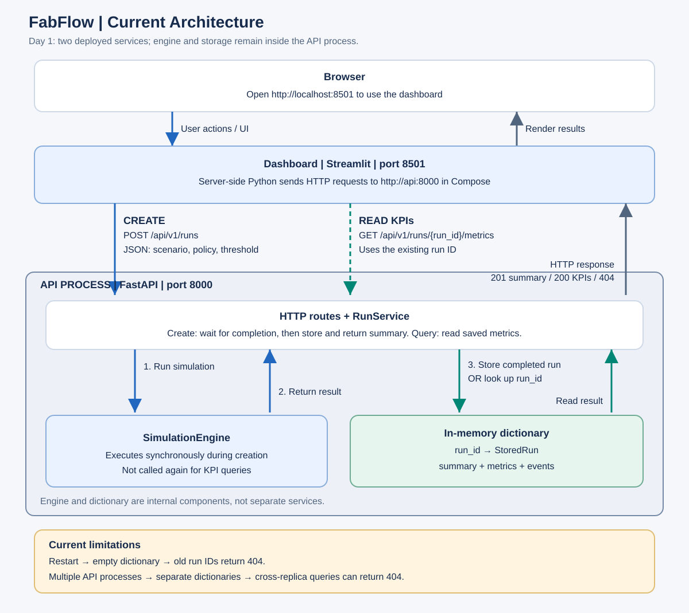

# Day 1: Understanding FabFlow Before Kubernetes

## Learning goal

Trace a simulation request from the browser to the API, identify where results
are stored, and explain why restarts and multiple API replicas affect queries.
These notes describe the current implementation, before any Kubernetes changes.
Today's work covered code reading and architecture reasoning; it did not include
a new deployment or runtime verification.

## Architecture



The editable Mermaid source is [day01-architecture.mmd](day01-architecture.mmd).
Both the simulation engine and the result dictionary live inside the API process.
They are not separate deployed services.

## Two services and their ports

| Component | Technology | Port | Responsibility |
| --- | --- | --- | --- |
| Dashboard | Streamlit | 8501 | Present controls and charts; send HTTP requests to the API |
| API | FastAPI | 8000 | Validate requests, execute simulations, store results, and answer queries |

The browser opens `http://localhost:8501` to use the dashboard. The dashboard's
Python code sends requests to the API. In Docker Compose, its configured API
base URL is `http://api:8000`: `api` is the Compose service name, resolved within
the container network. A host browser can separately open API documentation at
`http://localhost:8000/docs` through the published port.

If an already-running dashboard remains available while the API stops, the page
can still be accessed, but requests needing the API fail. If the dashboard stops
while the API stays available, direct API access can still work.

## Creating a simulation

1. The user selects a scenario, dispatch policy, and aging threshold in the dashboard.
2. Pressing **Run simulation** submits the form. The button itself does not send
   the API request; the subsequent `if submitted` block does.
3. `build_request(...)` prepares the validated payload.
4. The dashboard sends `POST /api/v1/runs`, including the settings as JSON.
5. The API calls `RunService.create(...)`, which runs `SimulationEngine` synchronously.
6. After the simulation completes, the service builds a `StoredRun` containing
   the summary, metrics, and events.
7. It stores the completed result in its dictionary and returns it to the route.
8. The API responds with HTTP 201 and the run summary, including `run_id`.
   The dashboard can then request the KPIs separately.

The request waits for simulation completion. This is not a background job queue.

```python
response = httpx.post(
    f"{api_url}/api/v1/runs",
    json=payload.model_dump(mode="json"),
    timeout=60.0,
)
```

## Reading existing results

| Request | Purpose |
| --- | --- |
| `GET /health/ready` | Check application readiness; does not query simulation results |
| `POST /api/v1/runs` | Execute and store a new simulation |
| `GET /api/v1/runs/{run_id}` | Read the stored summary |
| `GET /api/v1/runs/{run_id}/metrics` | Read the stored KPIs |
| `GET /api/v1/runs/{run_id}/events` | Read the stored event records |

For example, run `abc123` uses:

```text
http://api:8000/api/v1/runs/abc123/metrics
```

The metrics route's `get_stored_run` dependency calls `service.get(run_id)`.
If the run exists, `get_metrics` returns `stored.metrics`. If it is missing,
the dependency raises HTTP 404 with `Run not found`. Reading KPIs does not
execute the simulation engine again.

## Where data lives

```python
# Initialized for this RunService instance:
self._runs: dict[str, StoredRun] = {}

# Written after simulation completion:
self._runs[summary.run_id] = stored

# Read during a later query:
return self._runs.get(run_id)
```

- Key: the simulation's `run_id`.
- Value: a `StoredRun` containing summary, metrics, and events.
- Location: the API process's memory, not a database or file.
- The lock coordinates access within the process; it does not share data
  between different processes or replicas.

## Two limitations to explain in an interview

### Restart loses stored results

When the API process stops, its in-memory results disappear. Starting a new
process creates a new empty dictionary. A previous run ID therefore returns 404.
A cached result may remain visible in the dashboard, but a fresh API lookup fails.

### Replicas do not share dictionaries

If a POST creates a run in API A and a later GET reaches API B, B does not have
that run and returns 404. Identical code does not imply shared memory. This is
why increasing API replicas alone does not make the current application scale
correctly for result queries. The same issue applies to multiple API workers.

Future shared storage can address completed-result access and persistence.
It does not, by itself, guarantee that an in-progress simulation survives a crash.

## Source map

| File | What to inspect |
| --- | --- |
| [compose.yaml](../../compose.yaml) | Services, ports, API URL, and health checks |
| [Dockerfile](../../Dockerfile) | Separate API/dashboard targets and one API worker |
| [Dashboard main](../../app/dashboard/main.py) | Form submission, POST, readiness GET, and KPI GET |
| [Dashboard client helpers](../../app/dashboard/client.py) | Payload preparation and base URL validation |
| [API routes](../../app/api/runs.py) | Create/read routes, stored-run dependency, and 404 |
| [Run service](../../app/services/runs.py) | Engine invocation and dictionary reads/writes |
| [Application setup](../../app/main.py) | Application-owned RunService instance |

## Review checklist

- [x] Distinguish dashboard port 8501 from API port 8000.
- [x] Explain POST creation versus GET queries and readiness checks.
- [x] Trace simulation execution before result storage and response.
- [x] Identify the dictionary key, value, and memory location.
- [x] Explain restart data loss and cross-replica 404 responses.
- [x] Draft the current architecture by hand.
- [ ] Independently redraw both creation and KPI-query paths, including the API boundary.

## Next session

Run the existing Docker Compose workflow and HTTP smoke checks to establish a
working baseline before introducing Kubernetes. Record observed results separately
from assumptions. Deployment commands and Kubernetes manifests are future work.
