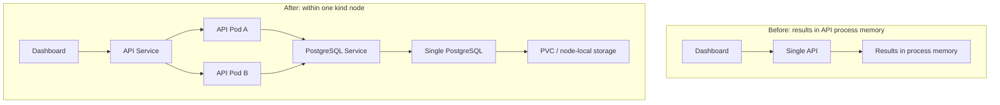

# Day 26: Architecture, Measurements, and Failure Boundaries

Status: Guided review and report complete; the learner requested progress
synchronization. Documentation awaits commit/CI. No new deployment, failure exercise,
or HTTP measurement occurred. Actual hours unrecorded. Progress: 26/30 (86.7%).

## Engineering outcome

FabFlow moved completed simulation results from API process memory to PostgreSQL.
Two API replicas can read the same saved results, including after one API Pod is
replaced. All components still share a single kind node, and PostgreSQL remains a
single instance: the system does not tolerate loss of the node or database service.
The architecture diagram below contrasts the historical and persistent designs.

Complete summary, metrics, and ordered events are committed before HTTP 201.
In-flight synchronous simulations remain in process memory; new Pods do not resume
or replay interrupted requests. A lost response after commit may leave a complete
DB row without client acknowledgment. No POST idempotency key is implemented.

## Deployment and evidence scope

| Namespace | Manager | Data boundary |
| --- | --- | --- |
| fabflow | Raw Kubernetes manifests | Its own DB/PVC |
| fabflow-helm | Helm | Its own DB/PVC; Day 20–22 measurements |
| fabflow-gitops | Argo CD using Helm rendering | Its own DB/PVC; manual synchronization |

One environment's successful query is not proof of another environment's integrity.
CI tests/builds but does not publish images or deploy them to kind. Accepted local
images were built locally and loaded into the node. GitOps tracks main using the
chart/values-kind.yaml with manual sync, without auto-sync/self-heal. See
[Day 18](day18-image-ci.md), [Day 19](day19-versioned-deployment.md), and
[Day 25](day25-gitops-sync.md).

This report summarizes Day 20–22 raw evidence. [Day 23](day23-deployment-handoff.md)
and Day 25 supplement workflow acceptance, not additional availability measurements.
Command duration, replica recovery, and HTTP interruption are separate quantities.

## Environment and measurement method

Local ARM64 single-node kind-fabflow, namespace fabflow-helm: two API replicas,
one dashboard, one PostgreSQL instance, local PVC. API source tag:
794dbaafc1697a8812358b30b0808c6100242ebe; dashboard:
395df1ec02a010163ea46e68374feb607c0c39bd. This is a local demonstration, not a
production-scale evaluation.

Day 20/22 used a fixed dashboard Pod and API Service with
[probe_rolling_update.py](../../scripts/probe_rolling_update.py). Each cycle
sequentially read readiness and saved summary/metrics/events, comparing complete
responses to the external snapshot. Target cycle interval 0.5s, no retries;
slow requests and scheduling delay later cycles, so sampling is not strictly uniform.
timeout=2 is a urllib/socket setting, not a strict total-request deadline.
JSONL UTC records request start; failed-start spans do not establish continuous outage.

## Results and interpretation

| Exercise | Time and definition | HTTP observations | Interpretation limit |
| --- | --- | --- | --- |
| Day 20 rolling update | Helm upgrade 6.818s, revision 4 -> 5 | 2,376 requests/5 failures in 300s, 0.2104% | Full-window proportion, not update-only rate; cause unconfirmed |
| Day 21 bad image | 90s wait before command failure, revision 6 failed | No continuous sampling; old API Pods remained Ready | Ready does not prove all requests succeeded |
| Day 21 rollback | Target revision 5, new revision 7; shell SECONDS=0; UTC 03:32:58Z–03:32:59Z | No continuous sampling | Coarse command timing, not zero-second recovery or downtime |
| Day 22 deletion 1 | 3.049s to two nonterminating Ready API Pods and old name absent | 960 requests/2 failures in 120s | Includes command/polling overhead, not HTTP downtime |
| Day 22 deletion 2 | Same definition, 3.694s | 908 requests/1 failure in 120s | Timeout about 77s after recovery; cannot directly attribute to deletion |
| Day 22 deletion 3 | Same definition, 3.583s | 960 requests/0 failures in 120s | No observed failure in this trial does not prove zero downtime elsewhere |

Day 20 had three refusals/two timeouts around replacement. No per-request destination,
EndpointSlice timeline, or old-container shutdown logs were captured; root cause
is unconfirmed. maxUnavailable=0 constrains available replicas, not request success.

Day 22 began timing before normal deletion and included API-server/command/polling
overhead. Another Pod could serve throughout replacement. Total full-window sample:
2,828 requests/3 failures (0.1061%). Two refusals occurred near the first deletion;
the second trial's timeout occurred after replica recovery. Neither establishes a
specific cause. No successful-response snapshot mismatch was observed. Final full
result and unknown-ID 404 checks passed.

## Original evidence and reproduction references

| Exercise | Evidence |
| --- | --- |
| Day 20 | [request JSONL](../../artifacts/day20/fabflow-day20-rolling-update.jsonl), [upgrade log](../../artifacts/day20/fabflow-day20-upgrade.log), [snapshot](../../artifacts/day20/fabflow-day20-before-update.json), [full method](day20-rolling-update.md) |
| Day 21 | [failed upgrade](../../artifacts/day21/bad-upgrade.log), [events](../../artifacts/day21/failed-pod-events.txt), [rollback log](../../artifacts/day21/rollback.log), [history](../../artifacts/day21/after-helm-history.txt), [correction](day21-bad-version-rollback.md) |
| Day 22 trial 1 | [requests](../../artifacts/day22/attempt1-probe.jsonl), [timing](../../artifacts/day22/attempt1-recovery.txt) |
| Day 22 trial 2 | [requests](../../artifacts/day22/attempt2-probe.jsonl), [timing](../../artifacts/day22/attempt2-recovery.txt) |
| Day 22 trial 3 | [requests](../../artifacts/day22/attempt3-probe.jsonl), [timing](../../artifacts/day22/attempt3-recovery.txt) |
| Day 22 verification | [snapshot](../../artifacts/day22/before-run.json), [final verification](../../artifacts/day22/after-verify.txt), [checked summary](../../artifacts/day22/checked-summary.json), [full method](day22-pod-recovery.md) |

Recount only type=request JSONL rows; count ok=false as failures, group by endpoint,
and correlate with command/timing logs. Do not mix trials, formal windows, or exercises.
Before repeating, verify context, namespace, Service, images, and snapshot using the
linked procedures; write new output files and preserve original evidence.

Day 21 before-run.json/after-verify.txt reached Compose IPv4 localhost:8000 while
Helm forwarding listened only on IPv6. Those original artifacts remain unchanged
but are excluded from Helm rollback data-integrity evidence. This does not establish
Helm data loss. Day 22's new Helm-Service snapshot does not retroactively validate
Day 21 rollback. Day 23 later verified full results across same-settings upgrade/
rollback without Pod rollout. Day 25 manual tag/drift/revert acceptance had no
continuous availability measurement or old-result snapshot acceptance.

## Failure boundaries

| Failure | Verified behavior | Remaining limitation |
| --- | --- | --- |
| Normal deletion of one API Pod | Day 22 retained complete results; another replica could serve; controller replaced Pod | Some requests failed; no hard kill or in-flight POST test |
| Temporary DB outage | [Day 15](day15-persistence-acceptance.md): both APIs returned 503 on creates/reads | API readiness ignores DB; DB is not HA |
| DB Pod replacement | Day 15 reused original PVC and retained complete results | Does not cover underlying storage corruption |
| Node or entire kind cluster loss | All components/storage depend on one node | Recovery untested; local PVC is not backup or guaranteed retention |

StorageClass reclaim policy is Delete; chart PVC has no keep policy. Uninstall or
PVC/namespace/cluster deletion may destroy data. No such cleanup occurs in this
report. Database unavailability does not by itself mean data loss.
Future work: verified backup/restore, shutdown/routing timeline capture, then measured
shutdown improvements. These remain unimplemented/unverified, with no claimed gains.

## Review and handoff

The learner explained persistence, DB-blind readiness, PVC limits, failure-rate
windows/causality, replica recovery versus downtime, and shared-node risk. At lesson
start the assistant read GitOps tracking main, Synced/Healthy, both APIs/dashboard/DB
Ready; both API Pods had one recent restart of unconfirmed cause. This was a status
snapshot without a separate raw archive, not evidence of current Day 20–22 health.

Original document checks verified 26 local links and four formal JSONL request/failure
counts; no full application tests were rerun for report-only edits. Workbook/AGENTS
were synchronized to 26/30 with hours blank. Day 27 later began README/demo work;
its timed rehearsal remains pending. Translation review does not change lesson acceptance.

## Recorded commands and examples

These blocks preserve the milestone procedures and recorded output in their original
order. They describe the historical configuration; review current manifests and
prerequisites before repeating them. Resource names and IP addresses are observations,
not fixed values.

