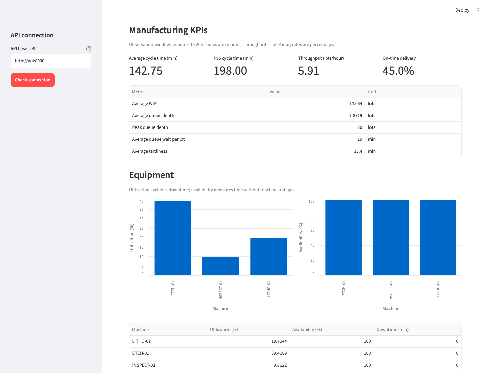
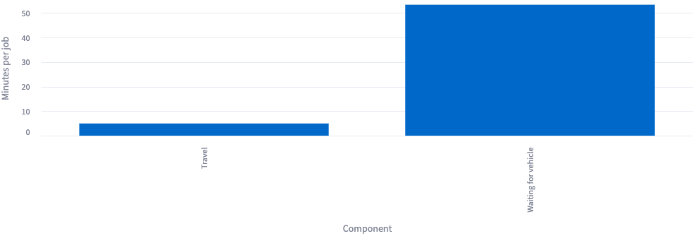

# FabFlow: semiconductor dispatching and AMHS simulator

FabFlow is a Python discrete-event simulator for exploring how dispatch decisions,
machine outages, and limited material-handling capacity affect a synthetic fab.
It connects a SimPy engine to a synchronous FastAPI service and Streamlit
dashboard, with Docker Compose and automated browser acceptance for a repeatable
local demonstration.

## Problem and implemented scope

Wafer lots compete for processing capacity and transport vehicles. A faster
dispatch policy or additional vehicles can change average cycle time, tail
latency, delivery performance, and equipment utilization in different ways.
FabFlow makes those trade-offs observable through event records, KPI calculation,
and reproducible comparison experiments.

The implemented MVP supports three manufacturing stages, FIFO/SPT/Critical Ratio,
Hot lot priority with Normal lot aging protection, machine failure/repair, and a
shared FIFO AMHS vehicle pool. The API validates explicit scenario inputs and
exposes completed summaries, KPIs, and events. The dashboard submits two preset
scenarios and displays manufacturing, equipment, and transport metrics.

## Dashboard evidence

The images below are unmodified screenshots from the successful Day 6 real
browser acceptance run against the Python 3.12 Compose stack. They use FIFO,
seed 42, and a 30-minute Normal lot aging threshold. Playwright 1.64.0 drove
headless Google Chrome 155.0.8059.80 at a 1440 × 1100 viewport on October 17,
2026, against application commit `2d83879`. The third image is the chart element
capture produced by the same script. All data is synthetic.

### Manufacturing baseline

20 lots complete at simulated minute 175. The screen shows a 70.50-minute average
cycle time, 113.00-minute P95, 6.86 lots/hour, and 65.0% on-time delivery.
Separate equipment charts distinguish productive utilization from availability.

### AMHS bottleneck

One shared vehicle serves 40 transport jobs. The run finishes at minute 203,
with a 142.75-minute average cycle time and 5.91 lots/hour. Equipment availability
is 100% in this no-failure preset even when utilization is low.

Average waiting for a vehicle is 53.375 minutes per job, compared with five
minutes of travel. The chart exposes the transport queue contribution directly.

These two dashboard presets have different workloads and processing resources;
their difference alone does not isolate the impact of enabling transportation.
Use the paired vehicle experiment below to evaluate vehicle capacity.

## Reproducible findings

| Experiment | Observed result | Scope |
| --- | --- | --- |
| FIFO/SPT/CR with seed 42 | SPT average cycle 36.37 min versus FIFO 39.77; CR P95 66.74 min versus SPT 71.74 | One 12-lot heterogeneous workload with shared failure calendars |
| One versus three AMHS vehicles | Average cycle 142.75 to 57.05 min; throughput 5.91 to 12.90 lots/hour | Same 20-lot workload and five-minute transfers |
| Three versus six vehicles | Throughput stays 12.90 lots/hour while average cycle drops to 55.00 min | Etching becomes the processing bottleneck |

These are simulator results, not measured improvements in a real fab. They
illustrate trade-offs for specific inputs rather than a universal policy ranking.
The [demo walkthrough](demo-walkthrough.md) includes commands, parameters, and
expected outputs; the [policy report](day3-comparison-report.md) and
[AMHS report](day4-amhs-report.md) retain the experiment details.

## Engineering decisions and verification

| Decision | Why it matters | Implementation |
| --- | --- | --- |
| Engine-owned random streams and fresh per-run entities | Keeps experiments repeatable and failure calendars comparable across policies | [Simulation engine](../simulator/engine.py) |
| Immutable event records and explicit KPI definitions | Makes lifecycle order and metric calculations inspectable | [Events](../simulator/events/event.py), [KPIs](../simulator/metrics/kpi.py) |
| Priority wrapper with Normal lot aging | Allows Hot insertion while protecting long-waiting Normal lots from starvation | [Dispatch wrapper](../simulator/policies/hot_lot.py) |
| Synchronous API with an isolated in-memory store | Keeps the MVP execution model simple and prevents partial-result publication | [Run service](../app/services/runs.py) |
| Dashboard as an HTTP client | Exercises the same API used by external clients and keeps simulation logic in the backend | [Dashboard](../app/dashboard/main.py) |
| Health-gated Compose startup and real browser checks | Verifies service connectivity and actual widget/chart behavior | [Compose](../compose.yaml), [browser acceptance](../scripts/smoke_browser.py) |

The fresh Python 3.12.14 verification passed 179 tests with 93% combined
statement/branch coverage across `app` and `simulator`. Ruff lint, formatting,
dependency consistency, and Compose configuration also passed. Both remote CI
jobs passed for `2d83879`, including real Chromium acceptance:
[verified workflow run](https://github.com/j22868706/sideproject_fabflow/actions/runs/39043904601).
Day 7 documentation changes have no separate remote CI result yet.

## Reuse in a project summary

Built a reproducible semiconductor manufacturing simulator with Python, SimPy,
FastAPI, and Streamlit. Implemented dispatch policies, priority aging, equipment
failure/repair, AMHS capacity constraints, and event-based KPIs. Delivered a
Docker Compose demo validated by 179 tests and real browser workflows; used
paired synthetic experiments to show dispatch and transport bottleneck trade-offs.

## Demonstration and limits

Start with `docker compose up --build --wait --wait-timeout 120`, then open
http://localhost:8501. Follow the [runbook](runbook.md) for dependencies, API
addresses, evidence generation, result exports, and shutdown.

The model uses synthetic inputs, fixed processing/travel times, and simplified
routing. It omits recipe qualification, setups, physical vehicle paths, and
stocker capacity. Results are process-local and disappear on API restart; use
one API worker. There is no production performance claim, persistent storage,
or public hosted deployment. Desktop Chrome and CI Chromium are verified;
mobile layouts and other browser engines have not been tested.

The three selected PNGs are tracked in `docs/images/` for GitHub viewing. Raw
browser traces and failure captures remain ignored under `artifacts/browser/`.
Regenerate evidence with `python scripts/smoke_browser.py` after installing the
browser extra; see [Day 6 acceptance](day6-dashboard.md#step-5-real-browser-acceptance-complete-locally).
